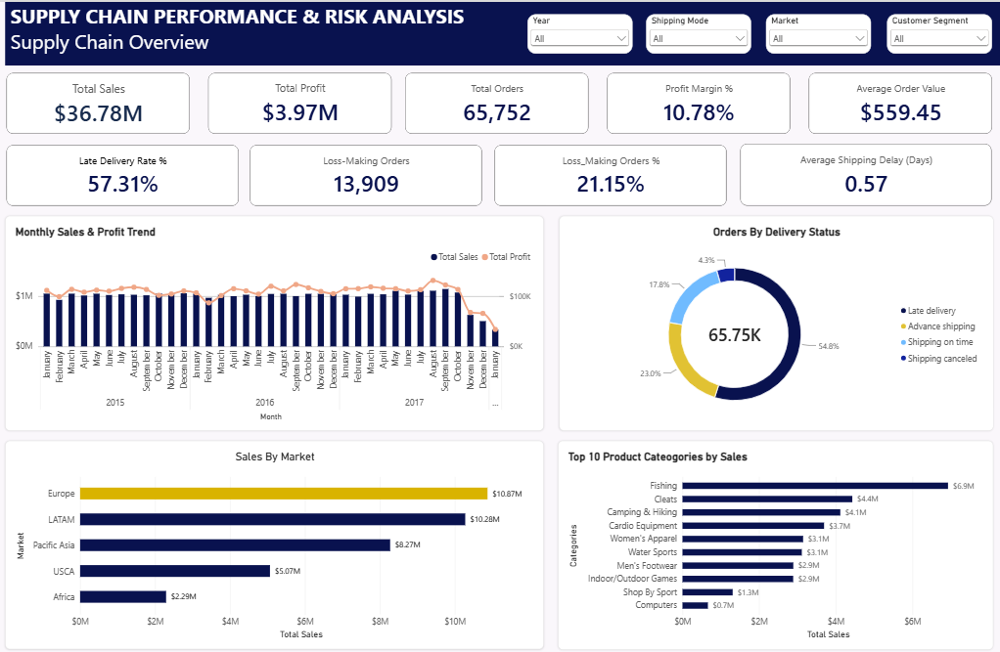
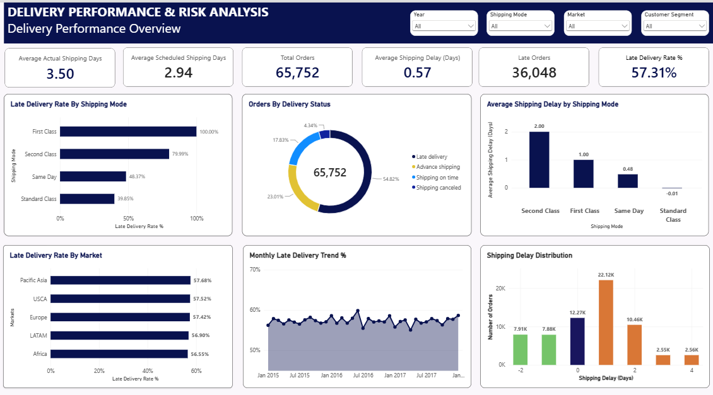
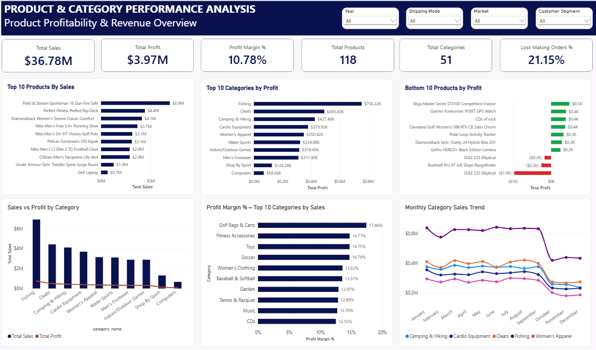

# Supply Chain Performance & Risk Analysis

## 1. Project Overview

In this project, I worked with DataCo SMART Supply Chain Dataset to understand the company's sales, profit, delivery performance and overall supply chain operations.

I used **Python**, **MySQL** and **Power BI** to complete the project.

First, I used python to explore and clean the dataset. This includes checking missing values, duplicates, data types and removing unnecessary columns. I also created a new column to calculate shipping delays.

After cleaning the data, I imported it into MySQL and wrote SQL queries to analyze different areas of the business. I focused on questions such as which products and categories were performing well, how shipping delays affected operations, which orders were making losses and how discounts were related to profitability.

Finally, I used Power BI to create three interactive dashboards covering overall business performance, delivery performance and risks and product and category analysis.

The main objective of this project was to practice the complete data analysis process, identify business problems and use data to find insights that could help improve business Performance.

### Key Areas Of Analysis

- **Sales Performance :** Understanding sales trends, total Orders, revenue, average order value.
- **Profitability analysis :** Analysing profit margins, loss making orders and impact of discounts on profit.
- **Delivery Performance :** Studying late deliveries, shipping delays and difference between actual and scheduled shipping times.
- **Shipping Mode Analysis :** Comparing different shipping modes to identify delivery issues and delays.
- **Product & Category Analysis :** Identifying top performing products and categories based on sales, profit and profit margin
- **Regional Performance :** Comparing sales, profitability and delivery risk across different markets and regions.
- **Customer Analysis :** Understanding customer spending patterns and identifying high value customers who may not be profitable.

The main purpose of this analysis is to understand how different parts of the supply chain are performing and identify areas where the business can improve.

## 2. Business Objectives

The main objective of this project was to understand the company's supply chain performance and identify areas where improvement could be made.

I focused on the following business questions:

1. How much revenue and profit is the company generating and how its performance changed over time?
2. Which products, categories and markets are generating the highest sales and profits?
3. How many orders are delivered late and which shipping modes have the most delivery issues.
4. Which regions and product categories have higher delivery risks.
5. How many orders are making losses and could be affecting their profitability.
6. How are discounts related to sales and profit margins?
7. Which customers generate high sales and those customers profitable for the business.
8. How does actual shipping time compare with scheduled shipping time ?

By answering these questions, I wanted to identify important business trends, undestand delivery and profitability issues and suggest the areas where the company could improve its performance.

## 3. Tools and Technologies Used

I used Python, MySQL and Power BI to clean the dataset, analyze business performance and present to findings through interactive dashboards.

### Python (Juypter Notebook) - Data Cleaning and Preparation

#### Libraries Used

- **Pandas :** Used for Data loading, cleaning and manipulation.
- **SQLAlchemy :** Used to connect the python with MySQL and import the cleaned dataset into the database.

s
#### Work Performed

- Loaded and explored the raw dataset.
- Checked missing values, duplicate records and data types
- Removed unnecessary columns and standardised column names.
- Converted order and shipping dates into correct format.
- Create a new column to calculate shipping delays.
- Exported cleaned data into a CSV file.
- Imported the cleaned dataset into MySQL for further analysis.

### MySQL - Data Analysis

#### Work Performed

- Imported and analysed the cleaned supply chain data.
- Used SQL queries to calculate important business metrics such as total sales, profit, profit margins and late delivery rate.
- Used GROUP BY, JOINs, CASE statements, CTEs and window functions to analyze the sales, delivery performance, discounts and profitability.
- Added Business Insights and recommendations based on the query results.
- Analyzed delivery performance across shipping modes, regions and product categories.
- Identified loss making orders and examined relationship between discounts and profitability.
- Compared customer spendings, regional performance and yearly sales growth.
- Documened Business Insights and recommendations based on the query result.

### Power BI - Data Visualization

- Created three interactive dashboards to present the analysis.
- Used DAX measures to calculated KPIs such as total sales, total Profits, profit margin, late delivery rate and loss making orders.
- Used Charts, KPI cards and slicers to make the data easier to understand and explore.

### Power BI Dashboards
 1. Supply Chain Overview
 2. Delivery Performance & Risk Analysis
 3. Product & Category Performance Analysis

## 4. Dataset Information

For this project, I used Supply Chain dataset, which is available on Kaggle. The dataset contains information about customer orders, products, sales, profits, shipping methods and delivery performance.

### Dataset Overview

| Details | Information |
|---------|-------------|
| **Dataset Name** | DataCo SMART Supply Chain |
| **Source** | Kaggle |
| **Total Records** | 1,80,519 |
| **Total Unique Orders** | 65,752 |
| **Total Customers** | 20,652 |
| **Total Products** | 118 |
| **Total Product Categories** | 51 |
| **Date Range** | January 2015 - January 2018 |
| **File Format** | CSV |

### Data Description

The dataset includes information such as:

- **Order details :** Order ID, order date, Order Status, Order Quantity.
- **Sales & Profit :** Sales Amount, Order Profit, Discounts and Product Prices.
- **Customer Details :** Customer ID and Customer Segments
- **Shipping Details :** Shipping mode, Scheduled shipping days, actual shipping days and delivery status.
- **Locations Details :** Markets, Orders Origin and country

Each row represents an order items, so a single order can have multiple rows in the dataset.

I used this information to analyse the sales, profitability, customer behaviour and delivery performance across different markets and product categories.

**Note :** The dataset contains records only upto January 2018, so 2018 is not a complete year.

## 5. Project Files & Folder Structures

This project contains the files used for data cleaning, SQL analysis and Power BI Dashboard development

| Project file | Description |
|--------------|-------------|
| Data | Contains two files cleaned supply chain data used for the SQL analysis and Power BI and Raw data downloaded from Kaggle |
| 01_data_cleaning.ipynb | Contains the Python code for the data exploration, cleaning, handling missing values, correcting data types and preparing dataset for the anaysis |
| Data_analysis_project.sql | Contains SQL Queries used to analyze sales, profitability, delivery performance, shipping delays, discounts and customer behaviour |
| Supply_Chain_Performance_and_Risk_Analysis.pbix | Contains three interactive dashboards covering supply chain overview, delivery performance and risk analysis, product and category performance |
| images | Contains screenshot of three Power BI dashboards for viewing analysis without opening Power BI | 

## 6. Power BI Dashboards

I created three interactive Power BI dashboards to analyze overall business performance, delivery efficiency, operational risks and product profitability.

### Dashboard 1 : Supply Chain Overview

This dashboard provides an overview of sales, profitability, order volume and supply chain performance.

**Key Areas Covered :**
- Total Sales, Total Profit, Total Orders and Profit Margin.
- Average Order Value and delivery performance KPIs.
- Monthly sales and profit trends.
- Delivery Status Distribution.
- Sales performance across different markets.
- Top 10 Product categories by sales.

### Dashboard 2 : Delivery Performance & Risk Analysis

This dashboard focuses on analyzing delivery performance, shipping efficiency and potential operational risk.

**Key Areas Covered :**

- **Delivery Performance KPIs:** Late orders, Late deliver rate, Average Shipping Days, Average Actual Shipping days, Average Scheduled Shipping Days.
- **Shipping Mode Analysis:** Comparison of late delivery rate and average shipping delays across different shipping modes.
- **Delivery status:** Distribution of orders based on their delivery status
- **Market Analsis:** Identification of markets with higher late delivery rates.
- **Monthly Delivery Trends:** Analysis of monthly late delivery rates to understand changes in delivery performance over time.
- **Shipping Delay Distribution:** Understanding how frequently orders are delivered early, on time, on late.

### Dashboard 3 : Product & Category Performance Analysis

This dashboard focuses on analyzing product and category performance based on sales, profit and profit margins.

**Key Areas Covered :**

- **Performance KPIs:** Total Sales, Total Profit, Profit Margin, Total Products, Total Categories and loss making order percentage.
- **Top Products by sales:** Identification of Top 10 products generating the highest sales.
- **Category Profitability:** Comparison of Top 10 product categories based on total profit.
- **Loss Making Products:** Idenfication of Bottom 10 products based on profitability.
- **Sales Vs Profit Analsis:** Comparison of sales and profit across leading product categories.
- **Profit Margin Analysis:** Evaluation of profit margins for top 10 categories by sales.
- **Monthly Category Sales Trends:** Anslysis of monthly sales patterns across the leading product categories.

**Power BI Report :** [Download_Power_BI_Report](Supply_Chain_Performance_and_Risk_Analysis.pbix)

## 7. Key Findings and Insights

The analysis revealed several important insights related to sales performance, profitability, delivery efficiency and operational risks.

**1. Overall Business Performance**
- The company generated approx. $36.78M in total sales and $3.97M in profit with an overall profit margin of 10.78%
- The total of 65,752 unique orders were recorded during the analysis period, with an AOV of $559.45
- Although the business generated substantial sales, its profit margin indicates an opportunity to investigate costs, discounts and loss making orders to identify potential improvements.

**2. Delivery Performance & operational risk**
- Approx. 57.31% of non cancelled orders were delivered late, indicating challenge in meeting scheduled delivery timelines.
- The average actual shipping time was 3.50 days, compared with an scheduled shipping time of 2.94 days.
- On average, shipment were delayed by approx. 0.57 days, highlighting gap between planned and actual shipping performance.
- The high late delivery indicates improving delivery planning, monitoring shipping performance and identifying the causes of delays should be important operational priorities.

**3. Shipping Mode Analysis**
- First class recorded 100% late delivery rate among non cancelled orders making it the highest risk shipping mode in the dataset.
- Delivery performance varied across shipping modes, indicating that the selected shipping method was an important factor in meeting scheduled delivery timelines.
- The analysis highlights the need to investigate First class delivery schedule and compare actual shipping times with promised delivery timelines.
- Improving shipping mode selection and monitoring delivery performance could help reduce late deliveries and improve overall supply chain efficiency.

**4. Product and Category Performance**
- The dataset contains 118 products across 51 product categories, allowing sales and profitability to be compared across different product groups.
- Approx. 21.15% of orders (13,909) were loss making, highlighting significant profitability concern.
- The analysis showed that sales performance and profitability should be evaluated separately, as high sales do not indicate high profits.
- Comparing top and bottom performing products helps identifying opportunities to improve product pricing, discount strategies and overall category profitability

**5. Discount and Profitability Analysis**
- The analysis examined the relationship between product discount, sales, profit margin and loss making orders.
- Comparing discount levels with profitability helps identify whether higher discounts are linked to lower profit margin
- The presence of loss making orders highlights the importance of reviewing pricing and discounts strategies alongside sales performance.
- Monitoring discounts at the product and category levels could help the business identify opportunities to improve profitability without affecting sales.

**6. Customer & Regional Analysis**
- The dataset contains 20,652 unique customers, allowing customer purchase behaviour and profitability to be analyzed.
- The analysis compared customer spending and profitability to understand whether customers generating higher sales also contributed higher profits.
- The delivery risk were also compared across markets to understand geographical difference in late delivery rates.

## 8. Business Recommendations

Based on the findings from SQL analysis and Power BI Dashboards, the following recommendation could help to improve overall supply chain performance.

**1. Improve Delivery Performance.**
- Review the reason behind the late deliveries paricularly in the first class shipping mode.
- Monitor the delivery performance regularly using KPIs such as Late Delivery Rate & Average shipping delay
- Improve delivery planning and coordination with logistic partners to reduce delays and increase on time deliveries.

**2. Optimize Shipping Mode Selection**
- Review shipping mode selection based on delivery urgency and operational requirements.
- Regulary monitor the shipping mode performance to identify improvements and reduce delivery risks.

**3. Improve Product & Category Profitability**
- Investigate the 13,909 loss making orders to identify potential issue related to pricing, discounts and operational costs.
- Review the profitability of the product categories that generates the high sales but relatively low profits.
- Monitor products and category profit margins regularly to identify declining profitability.
- Prioritize product and categories that contributes positively to both salesa and profit

**4. Review Discount Strategies**
- Review discount offered on products and categories that frequently generate losses.
- Apply appropriate discount limits based on the products profitablity to reduce risk of loss making sales.
- Regulary evaluate the discount strategies to maintain balance between attracting customers and protecting profit margins.

**5. Improve Customer & Regional Performance**
- Review the customers who generates high sales but relatively low profit to understand potential pricing and discount related issues.
- Compare sales, profit margins and delivery performance across different markets and regions to identify the areas requiring improvement.
- Prioritize operational improvements in regions experiencing consistently high late delivery rates.

## 9. Conclusion

This project helped me understand how data analysis can be used the evaluate supply chain performance and identify business challenges.

Using Python, I cleaned and prepared the dataset for the analysis. I then used the MySQL to explore sales trends, profitability, delivery performance, shipping delays and customer behaviour. Finally I developed three interactive Power BI dashboard to present the findings in a clear and understandable way.

The analysis highlighted important area of concern including high late delivery rates, difference in shipping mode performance, loss making orders.

Through the project, I gained the practical experience in data cleaning, SQL based business analysis, data visualization and translating analytical findings into business recommendations.

Overall this project strengthen my understanding of the end to end data analysis process and how data driven insights can support better business decisions.
